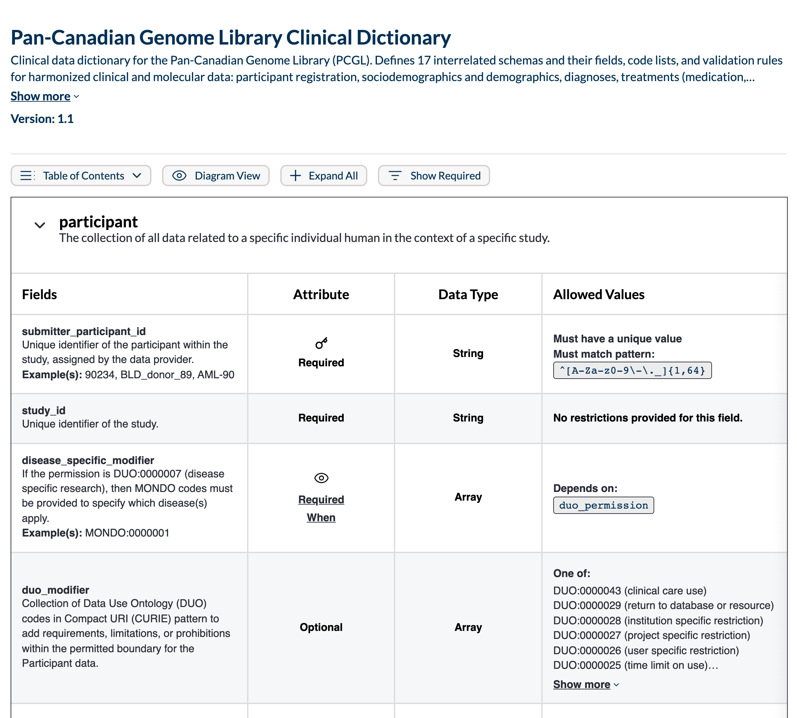
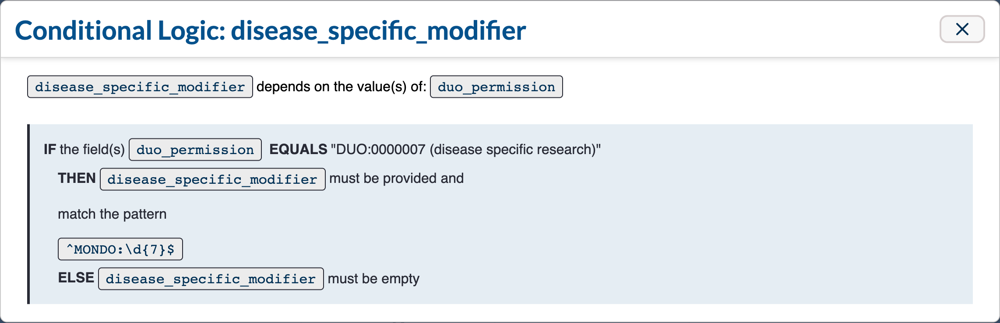
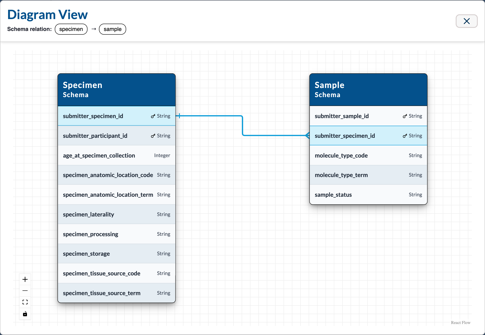
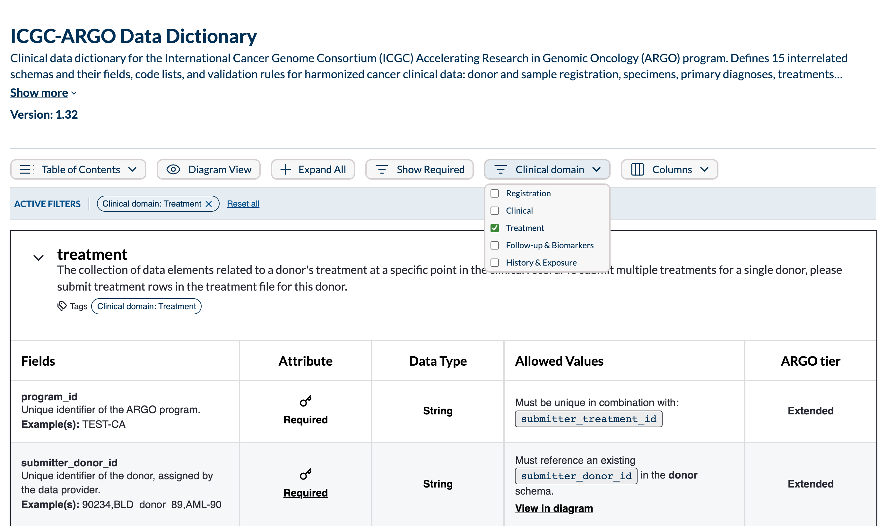

# Viewer Examples

The same viewer components rendering two real clinical data dictionaries: the Pan-Canadian Genome Library (PCGL) dictionary with no extra configuration, and the ICGC-ARGO dictionary with a custom column and a metadata filter added through props. These are the examples shown in the Dictionary Viewer manuscript.

Both run in [Storybook](./01-setup.md#run-storybook) under **Viewer - Table / Example Dictionaries**. The stories replace the dictionary name and description shown in the header with the text used in the manuscript; everything below the header is rendered from the dictionary files as stored, and the JSON on this page shows the stored values.

## PCGL clinical dictionary

[`pcgl.json`](https://github.com/overture-stack/lectern/blob/main/packages/ui/stories/fixtures/pcgl.json) is the PCGL clinical dictionary (`prod_pcgl_schema`, version 1.1): 17 schemas, 136 fields, and 17 foreign-key declarations, from [`lectern/pcgl/pcgl_lectern.json`](https://github.com/Pan-Canadian-Genome-Library/data-dictionary/blob/9bd7d3a75aeb3c87ca515b4c09dca6a6af768a34/lectern/pcgl/pcgl_lectern.json) in the PCGL data-dictionary repository. The repository copy also adds a few `meta.mappings.FHIRSpec` and `meta.ontologyRef` links used by the custom-column stories; this example does not display them.

No viewer configuration is needed beyond a [data source](./01-setup.md#choose-a-data-source):

```tsx
<DictionaryStaticDataProvider staticDictionaries={[pcglDictionary]}>
	<DictionaryTableStateProvider>
		<DictionaryTableViewer />
	</DictionaryTableStateProvider>
</DictionaryStaticDataProvider>
```

### Field table



The `participant` schema expanded, with the required-fields filter cleared ("Show Required"). Each row is one field: the key icon marks a field with `unique: true` or listed in the schema's `uniqueKey`, "Required When" marks a conditional restriction, and the Allowed Values column renders `unique`, `regex`, and `codeList` in plain language.

### Conditional logic



Clicking "Required When" on `participant.disease_specific_modifier` opens its conditional restriction, the `if` / `then` / `else` block in the JSON below, as a readable rule.

### Relationship diagram



"View in diagram" on `sample.submitter_specimen_id` opens the diagram focused on that foreign key, declared in the `sample` schema's `restrictions.foreignKey`.

<details>
<summary>PCGL JSON: the <code>participant</code> and <code>sample</code> schemas (2 of 17)</summary>

The [full file](https://github.com/overture-stack/lectern/blob/main/packages/ui/stories/fixtures/pcgl.json) has all 17 schemas.

```json
{
	"name": "prod_pcgl_schema",
	"version": "1.1",
	"description": "Base clinical schema that incorporates all PCGL base entities",
	"schemas": [
		{
			"name": "participant",
			"description": "The collection of all data related to a specific individual human in the context of a specific study.",
			"fields": [
				{
					"meta": {
						"displayName": "submitter_participant_id",
						"mappings": {
							"CQDG": "submitter_participant_id",
							"mCODE.STU3": "Patient.Identifier",
							"FHIR": "Patient.Identifier",
							"Phenopacket": "individual.id",
							"BeaconV2": "individual.id",
							"ARGO": "submitter_participant_id",
							"MOH": "submitter_participant_id",
							"FHIRSpec": "https://hl7.org/fhir/R4/patient.html"
						},
						"examples": ["90234", "BLD_donor_89", "AML-90"]
					},
					"name": "submitter_participant_id",
					"description": "Unique identifier of the participant within the study, assigned by the data provider.",
					"restrictions": {
						"required": true,
						"regex": "^[A-Za-z0-9\\-\\._]{1,64}"
					},
					"valueType": "string",
					"unique": true
				},
				{
					"meta": {
						"displayName": "study_id",
						"mappings": {
							"ARGO": "studyId",
							"CQDG": "study_id"
						}
					},
					"name": "study_id",
					"description": "Unique identifier of the study.",
					"restrictions": {
						"required": true
					},
					"valueType": "string"
				},
				{
					"meta": {
						"displayName": "disease_specific_modifier",
						"examples": ["MONDO:0000001"],
						"ontologyRef": "https://www.ebi.ac.uk/ols4/ontologies/mondo"
					},
					"name": "disease_specific_modifier",
					"description": "If the permission is DUO:0000007 (disease specific research), then MONDO codes must be provided to specify which disease(s) apply.",
					"valueType": "string",
					"restrictions": {
						"if": {
							"conditions": [
								{
									"fields": ["duo_permission"],
									"match": {
										"value": "DUO:0000007 (disease specific research)"
									},
									"case": "all"
								}
							]
						},
						"then": {
							"required": true,
							"regex": "^MONDO:\\d{7}$"
						},
						"else": {
							"required": false,
							"empty": true
						}
					},
					"isArray": true,
					"delimiter": "|"
				},
				{
					"meta": {
						"displayName": "duo_modifier",
						"mappings": {
							"CQDG": "duo_modifier"
						}
					},
					"name": "duo_modifier",
					"description": "Collection of Data Use Ontology (DUO) codes in Compact URI (CURIE) pattern to add requirements, limitations, or prohibitions within the permitted boundary for the Participant data.",
					"valueType": "string",
					"restrictions": {
						"codeList": [
							"DUO:0000043 (clinical care use)",
							"DUO:0000029 (return to database or resource)",
							"DUO:0000028 (institution specific restriction)",
							"DUO:0000027 (project specific restriction)",
							"DUO:0000026 (user specific restriction)",
							"DUO:0000025 (time limit on use)",
							"DUO:0000024 (publication moratorium)",
							"DUO:0000022 (geographical restriction)",
							"DUO:0000021 (ethics approval required)",
							"DUO:0000020 (collaboration required)",
							"DUO:0000019 (publication required)",
							"DUO:0000018 (not for profit, non commercial use only)",
							"DUO:0000046 (non-commercial use only)",
							"DUO:0000045 (not for profit organisation use only)",
							"DUO:0000016 (genetic studies only)",
							"DUO:0000015 (no general methods research)",
							"DUO:0000012 (research specific restrictions)",
							"DUO:00000044 (population origins or ancestry research prohibited)"
						]
					},
					"isArray": true,
					"delimiter": "|"
				},
				{
					"meta": {
						"displayName": "duo_permission",
						"mappings": {
							"CQDG": "duo_permission"
						}
					},
					"name": "duo_permission",
					"description": "Select one of the Data Use Ontology (DUO) codes in Compact URI (CURIE) pattern to indicate permitted uses or focused areas of research for the Participant data.",
					"restrictions": {
						"required": true,
						"codeList": [
							"DUO:0000042 (general research use)",
							"DUO:0000006 (health or medical or biomedical research)",
							"DUO:0000007 (disease specific research)",
							"DUO:0000011 (population origins or ancestry research only)",
							"DUO:0000004 (no restriction)"
						]
					},
					"valueType": "string"
				}
			]
		},
		{
			"name": "sample",
			"description": "Refers to the molecular material (e.g., DNA, RNA, protein) extracted from the specimen and used for experiments or analysis.",
			"fields": [
				{
					"meta": {
						"displayName": "submitter_sample_id",
						"mappings": {
							"FHIR": "submitter_sample_id",
							"mCODE": "submitter_sample_id",
							"MOH": "submitter_sample_id",
							"ARGO": "submitter_sample_id"
						},
						"examples": ["hnc_12", "CCG_34_94583", "BRCA47832-3239"]
					},
					"name": "submitter_sample_id",
					"description": "Unique identifier of the sample within the study, assigned by the data provider.\n",
					"restrictions": {
						"required": true,
						"regex": "^[A-Za-z0-9\\-\\._]{1,64}$"
					},
					"valueType": "string",
					"unique": true
				},
				{
					"meta": {
						"displayName": "submitter_specimen_id",
						"mappings": {
							"CQDG": "submitter_biospecimen_id",
							"mCODE.STU3": "Specimen.Identifier",
							"FHIR": "Specimen.Identifier",
							"Phenopacket": "biosample.id",
							"BeaconV2": "biosample.id",
							"ARGO": "submitter_specimen_id",
							"MOH": "submitter_specimen_id"
						},
						"examples": ["LAML_PO", "00445", "THY_099-tumour"]
					},
					"name": "submitter_specimen_id",
					"description": "Unique identifier of the specimen within the study, assigned by the data provider.",
					"restrictions": {
						"required": true,
						"regex": "^[A-Za-z0-9\\-\\._]{1,64}$"
					},
					"valueType": "string"
				},
				{
					"meta": {
						"displayName": "molecule_type_code",
						"mappings": {
							"CQDG": "sample_type",
							"Phenopacket": "sample_type",
							"BeaconV2": "biosample.sample_type",
							"GA4GH.Experiment.Metadata.Checklist": "molecule_type"
						},
						"examples": ["NCIT:C449", "NCIT:C812", "NNCIT:C80376", "SO:0000991", "SO:0000234", "SO:0001877"]
					},
					"name": "molecule_type_code",
					"description": "Indicate NCIT or SO code to denote the type of source material used for sequencing and analysis.\nProvide code in Compact URI (CURIE) pattern.",
					"restrictions": {
						"required": true,
						"regex": "^NCIT:C[0-9]+$|^SO:\\d{7}$"
					},
					"valueType": "string"
				},
				{
					"meta": {
						"displayName": "molecule_type_term",
						"examples": ["DNA"]
					},
					"name": "molecule_type_term",
					"description": "Provide the standardized and human readable term derived from the coding system associated with molecule type code.",
					"valueType": "string"
				},
				{
					"meta": {
						"displayName": "sample_status",
						"mappings": {
							"Phenopacket": "sample_status"
						}
					},
					"name": "sample_status",
					"description": "Indicate the status of the sample for data analysis.",
					"restrictions": {
						"required": true,
						"codeList": ["Case", "Control", "Not applicable"]
					},
					"valueType": "string"
				}
			],
			"restrictions": {
				"foreignKey": [
					{
						"schema": "specimen",
						"mappings": [
							{
								"local": "submitter_specimen_id",
								"foreign": "submitter_specimen_id"
							}
						]
					}
				]
			}
		}
	]
}
```

</details>

## ICGC-ARGO data dictionary

[`argo.json`](https://github.com/overture-stack/lectern/blob/main/packages/ui/stories/fixtures/argo.json) is a Lectern-format conversion of [ICGC-ARGO dictionary](https://github.com/icgc-argo/argo-dictionary) release 1.32: 15 schemas and 245 fields. For this example, schema-level `meta.category` values, example values, simplified conditional restrictions, and foreign-key declarations were added; ARGO's JavaScript validation scripts have no Lectern equivalent and are not included.

The example declares one [custom column](./01-setup.md#add-custom-columns) and one [metadata filter](./01-setup.md#add-metadata-filters):

```tsx
<DictionaryTableViewer
	filterDropdowns={[{ label: 'Clinical domain', filterProperty: 'meta.category' }]}
	customColumns={[{ columnHeader: 'ARGO tier', metaPath: 'meta.tier' }]}
/>
```



Each prop reads a path in the dictionary JSON:

- `filterProperty: 'meta.category'` is read from every schema. The Clinical domain dropdown lists the distinct values found, and selecting Treatment keeps only schemas whose `meta.category` is `"Treatment"`, each tagged with the filter's label.
- `metaPath: 'meta.tier'` is read from every field and shown in the ARGO tier column. The Columns control can hide it.

<details>
<summary>ICGC-ARGO JSON: the <code>treatment</code> schema (3 of 22 fields shown)</summary>

The [full file](https://github.com/overture-stack/lectern/blob/main/packages/ui/stories/fixtures/argo.json) has all 15 schemas, and the `references` that `#/regex/...` values resolve against.

```json
{
	"name": "ICGC-ARGO Data Dictionary",
	"version": "1.32",
	"description": "Clinical data dictionary for the International Cancer Genome Consortium (ICGC) Accelerating Research in Genomic Oncology (ARGO) program. Defines 15 interrelated schemas and their fields, code lists, and validation rules for harmonized cancer clinical data — donor and sample registration, specimens, primary diagnoses, treatments (chemotherapy, radiation, hormone therapy, immunotherapy, surgery), follow-ups, biomarkers, comorbidities, exposures, and family history.",
	"schemas": [
		{
			"name": "treatment",
			"description": "The collection of data elements related to a donor's treatment at a specific point in the clinical record. To submit multiple treatments for a single donor, please submit treatment rows in the treatment file for this donor.",
			"meta": {
				"parent": "donor",
				"category": "Treatment"
			},
			"fields": [
				{
					"name": "program_id",
					"valueType": "string",
					"description": "Unique identifier of the ARGO program.",
					"meta": {
						"displayName": "Program ID",
						"examples": "TEST-CA",
						"tier": "Extended"
					},
					"restrictions": {
						"required": true
					}
				},
				{
					"name": "submitter_donor_id",
					"description": "Unique identifier of the donor, assigned by the data provider.",
					"valueType": "string",
					"meta": {
						"displayName": "Submitter Donor ID",
						"examples": "90234,BLD_donor_89,AML-90",
						"tier": "Extended"
					},
					"restrictions": {
						"required": true,
						"regex": "#/regex/submitter_id"
					}
				},
				{
					"name": "submitter_treatment_id",
					"description": "Unique identifier of the treatment, assigned by the data provider.",
					"valueType": "string",
					"meta": {
						"displayName": "Submitter Treatment ID",
						"examples": ["TEST_TREATMENT_zzespofnsa", "TEST_TREATMENT_dqimtzujzw", "TEST_TREATMENT_mzikxjbsyt"],
						"tier": "Extended"
					},
					"restrictions": {
						"required": true,
						"regex": "#/regex/submitter_id"
					}
				}
			],
			"restrictions": {
				"uniqueKey": ["program_id", "submitter_treatment_id"],
				"foreignKey": [
					{
						"schema": "donor",
						"mappings": [
							{
								"local": "submitter_donor_id",
								"foreign": "submitter_donor_id"
							}
						]
					},
					{
						"schema": "primary_diagnosis",
						"mappings": [
							{
								"local": "submitter_primary_diagnosis_id",
								"foreign": "submitter_primary_diagnosis_id"
							}
						]
					}
				]
			}
		}
	]
}
```

</details>
